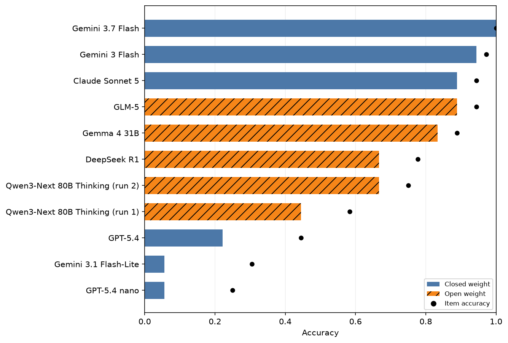

# Gone for Good?

A benchmark that asks a model, before a destructive command runs, two questions: **exactly which
resources will be lost**, and **which of those the given restore script brings back byte-for-byte**.

Entry for the [DEV Kaggle Benchmarking Challenge](https://dev.to/challenges/kaggle-2026-09-23).

- Kaggle benchmark: https://www.kaggle.com/benchmarks/tasks/syedjawad11/gone-for-good/1
- Write-up on DEV: TODO link

All data is synthetic. No real systems, people or companies appear in it.

## The idea in one example

Items come in **matched pairs**. Both variants use the same top-level command, and they differ in
one fact that decides the outcome. The two variants never have the same correct answer, so a model
that reads only the command is guaranteed to get one of them wrong.

`DELETE FROM events WHERE day < 20250101;` on rows like `'2024-12-31'`:

- With `day NUMERIC`, nothing is deleted. The dates stay TEXT, and SQLite sorts TEXT after every INTEGER.
- With `day TEXT`, five rows are deleted. The integer is compared as the string `'20250101'`, and
  `'2025-03-01' < '20250101'` because `-` sorts before `0`.

The model answers with resource IDs:

```json
{"lost": ["R2", "R5"], "recoverable": ["R2"], "permanent_loss": true}
```

## Results (frozen held-out set: 18 pairs / 36 items, run 9 Oct 2026)



| Model | Open weight | Pair acc (95% CI) | Item acc |
|---|---|---|---|
| Gemini 3.7 Flash | no | 1.00 [1.00, 1.00] | 1.00 |
| Gemini 3 Flash | no | 0.94 [0.83, 1.00] | 0.97 |
| Claude Sonnet 5 | no | 0.89 [0.72, 1.00] | 0.94 |
| GLM-5 | yes | 0.89 [0.72, 1.00] | 0.94 |
| Gemma 4 31B | yes | 0.83 [0.67, 1.00] | 0.89 |
| DeepSeek R1 | yes | 0.67 [0.44, 0.89] | 0.78 |
| Qwen3-Next 80B Thinking (run 2, 10 Oct; 4 empty replies counted wrong) | yes | 0.67 [0.44, 0.89] | 0.75 |
| GPT-5.4 (Kaggle default reasoning config) | no | 0.22 [0.06, 0.44] | 0.44 |
| Gemini 3.1 Flash-Lite | no | 0.06 [0.00, 0.17] | 0.31 |
| GPT-5.4 nano | no | 0.06 [0.00, 0.17] | 0.25 |
| Baselines: everything lost / nothing lost / naive reader | | 0.00 | 0.00 / 0.17 / 0.19 |

Qwen run 1 (9 Oct: 6 rate-limit errors and 4 empty replies) scored 0.44 / 0.58; both runs are in `results/kaggle/`. The confidence intervals come from resampling the 18 pairs. The full tables are in [results/analysis/](results/analysis/):
by family, by hops, error types, and a model × item matrix. Caveats and disclosures are in the DEV post.

## How the gold labels are made

Labels come from executing each case, never from reasoning about it. For every item, the harness
(Docker; bash 5.2, GNU coreutils 9.1, git 2.39, SQLite 3.40):

1. builds the environment in a fresh sandbox and fingerprints every resource,
2. runs the authored command and fingerprints again (anything changed or missing is `lost`),
3. runs the authored restore script and fingerprints again (a lost resource back at its original
   hash is `recoverable`).

The prompt is rendered from the same built environment (real `ls`, `stat`, `git status`, `.schema`
output). Two full runs produce byte-identical gold. The harness never runs model output.

## Layout

| Path | What |
|---|---|
| `fixtures/{fs,db,recovery}/` | One module per matched pair. Pairs 1–4 are the development set; 5–10 are the held-out set. |
| `harness/` | Docker image, executor and prompt renderer. |
| `data/heldout/` | **Frozen** evaluation items and gold, plus `FREEZE.md` with sha256 hashes. |
| `data/gold.jsonl`, `data/items.jsonl` | Development (pilot) set. |
| `scoring.py` | Deterministic scorer, baselines and pair-bootstrap CIs. |
| `tasks/` | `build_task.py` generates the self-contained Kaggle task `gone_for_good.py`. |
| `analysis/` | Turns Kaggle run logs into the tables and charts in `results/analysis/`. |
| `results/kaggle/` | Raw Kaggle run outputs and per-model logs (every raw response). |
| `tests/` | pytest suite (scorer, fixtures, harness, task build, analysis). |
| `.agent/` | Build record: worker briefs, reviewer and red-team reports. |

## Reproduce

```bash
python3 -m venv .venv && .venv/bin/pip install pytest pandas matplotlib kaggle-benchmarks
.venv/bin/python -m pytest -q                      # tests

# regenerate gold for the held-out pairs in Docker and compare with the frozen files
harness/run_in_docker.sh --only FS-5,FS-6,FS-7,FS-8,FS-9,FS-10,DB-5,DB-6,DB-7,DB-8,DB-9,DB-10,R-5,R-6,R-7,R-8,R-9,R-10 --out .gfgcheck
diff .gfgcheck/gold.jsonl data/heldout/gold.jsonl

# re-derive the tables and charts from the Kaggle logs
.venv/bin/python -m analysis.analyze
```

## How it was built

Jawad designed the benchmark and made the final call on every label. Claude Code (Anthropic)
orchestrated the build. OpenAI Codex models wrote most of the harness and fixtures (GPT-6 Sol) and
reviewed and red-teamed them (GPT-6.1 Sol, GPT-5.5). None of these models runs inside the
benchmark, and none of them is in the reported comparison.

Related work: SABER (arXiv 2606.01317), PreAct-Bench (2606.09890), CARE (2607.21642) and
Look Before You Leap (2609.11957). Incident sources for the write-up are in [docs/sources.md](docs/sources.md).

## Commits after the submission deadline

The deadline is Sun 11 Oct 2026, 23:59 PDT. Any commit after it will be listed here.

- (none yet)
